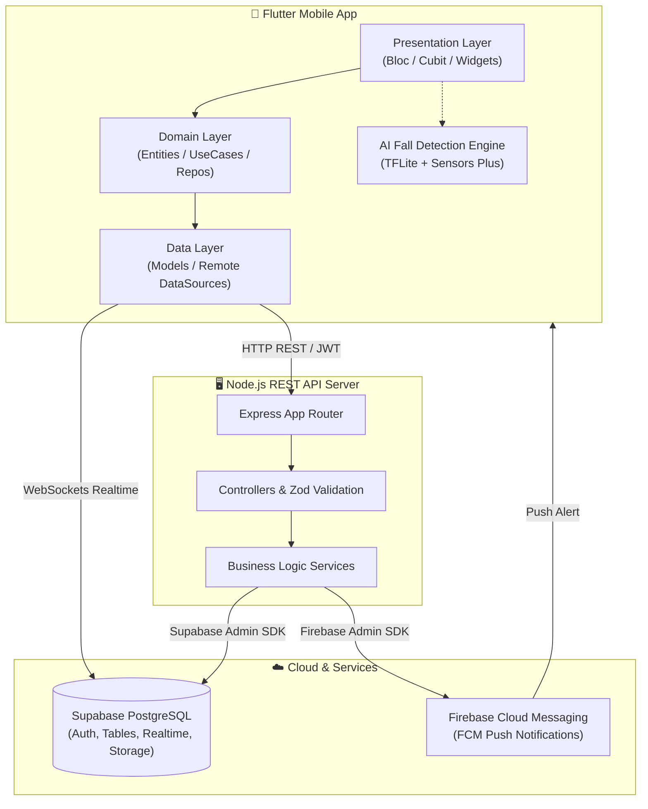

# 🛡️ Family Guard - Hệ Sinh Thái Chăm Sóc & Bảo Vệ Gia Đình Thông Minh

<p align="center">
  
  
  
  
  
  
  
</p>

---

## 📖 Mục lục

- [Giới thiệu](#-giới-thiệu)
- [Tính năng nổi bật](#-tính-năng-nổi-bật)
- [Kiến trúc hệ thống](#-kiến-trúc-hệ-thống)
- [Công nghệ sử dụng](#-công-nghệ-sử-dụng)
- [Cấu trúc dự án](#-cấu-trúc-dự-án)
- [Hướng dẫn cài đặt & Khởi chạy](#-hướng-dẫn-cài-đặt--khởi-chạy)
  - [1. Yêu cầu môi trường](#1-yêu-cầu-môi-trường)
  - [2. Cấu hình cơ sở dữ liệu Supabase](#2-cấu-hình-cơ-sở-dữ-liệu-supabase)
  - [3. Cấu hình & Chạy Backend](#3-cấu-hình--chạy-backend)
  - [4. Cấu hình & Chạy Flutter App](#4-cấu-hình--chạy-flutter-app)
- [Phân quyền & Giao diện thích ứng (Role Matrix)](#-phân-quyền--giao-diện-thích-ứng-role-matrix)
- [Tài liệu API Backend](#-tài-liệu-api-backend)
- [Đóng góp & Giấy phép](#-đóng-góp--giấy-phép)

---

## 🌟 Giới thiệu

**Family Guard** là giải pháp phần mềm toàn diện giúp các thành viên trong gia đình kết nối, theo dõi vị trí và chăm sóc sức khỏe lẫn nhau. Ứng dụng được thiết kế đặc thù cho các hộ gia đình đa thế hệ, hỗ trợ tối đa việc bảo vệ **Trẻ em** và chăm sóc **Người cao tuổi** thông qua công nghệ định vị GPS thời gian thực, vùng an toàn địa lý (Geofencing), và **trí tuệ nhân tạo (AI/TFLite) phát hiện té ngã ngay trên thiết bị**.

---

## 🚀 Tính năng nổi bật

### 1. 📍 Định vị GPS & Vùng an toàn (Geofencing)
- **Theo dõi thời gian thực**: Xem vị trí trực tiếp của các thành viên trên nền bản đồ trực quan (`flutter_map` / OpenStreetMap / Mapbox).
- **Lịch sử di chuyển & Xem lại lộ trình (Route Playback)**: Lưu vết và mô phỏng lại hành trình di chuyển theo từng khung giờ trong ngày.
- **Vùng an toàn thông minh (Safe Zones)**: Thiết lập bán kính an toàn (Nhà riêng, Trường học, Viện dưỡng lão, Công viên) kèm quy tắc thời gian (Time Rules). Tự động gửi cảnh báo khi thành viên rời hoặc vào vùng an toàn.

### 2. 🚨 Cảnh báo khẩn cấp & Phát hiện té ngã bằng AI
- **Phát hiện té ngã bằng TensorFlow Lite**: Phân tích dữ liệu cảm biến gia tốc và con quay hồi chuyển (`sensors_plus`) chạy mô hình AI trực tiếp trên điện thoại để nhận diện nguy cơ té ngã của người già theo thời gian thực.
- **SOS khẩn cấp một chạm**: Gửi cảnh báo tức thời kèm vị trí tọa độ chính xác tới toàn bộ người chăm sóc khi có sự cố.
- **Màn hình cảnh báo chuyên dụng**: Điều hướng nhanh đến vị trí người gặp nạn trên bản đồ cứu trợ.

### 3. 💊 Quản lý sức khỏe & Nhắc nhở đa dạng
- **Nhắc nhở uống thuốc & sinh hoạt**: Tạo lịch nhắc nhở cá nhân hóa, hỗ trợ **ghi âm giọng nói người thân** giúp người già và trẻ nhỏ dễ tiếp thu hơn.
- **Lịch hẹn khám y tế (Medical Appointments)**: Quản lý ngày tái khám, bác sĩ phụ trách và địa điểm khám bệnh.
- **Vận động thể chất (Physical Activities)**: Theo dõi số bước chân, mức độ vận động hàng ngày và nhật ký hoạt động thể chất.

### 4. 💬 Liên lạc & Kết nối gia đình
- **Trò chuyện trực tuyến (Realtime Chat)**: Nhắn tin trò chuyện tức thì giữa các thành viên qua Supabase Realtime channel.
- **Cuộc gọi nội bộ (In-app Calling)**: Gọi thoại kết nối nhanh giữa các thành viên trong gia đình.
- **Danh bạ ưu tiên**: Danh sách số liên lạc khẩn cấp hiển thị trực tiếp để quay số nhanh khi cần.

### 5. 👥 Giao diện thích ứng theo vai trò (Role-Based Dynamic UI)
- **Giao diện Người chăm sóc (Adult/Caregiver)**: Bảng điều khiển quản trị toàn diện, xem vị trí tất cả thành viên, quản lý vùng an toàn, duyệt lịch sử và thiết lập nhắc nhở.
- **Giao diện Người cao tuổi (Senior)**: Nút bấm lớn, font chữ tối ưu, nút SOS nổi bật, tập trung vào theo dõi sức khỏe và nhận nhắc nhở giọng nói.
- **Giao diện Trẻ em (Kid)**: Trực quan, giao diện học tập/sinh hoạt, nhắc nhở nhiệm vụ hàng ngày và bảo vệ an toàn.

---

## 🏗️ Kiến trúc hệ thống



---

## 💻 Công nghệ sử dụng

| Lĩnh vực | Công nghệ | Mục đích |
|---|---|---|
| **Mobile App** | [Flutter](https://flutter.dev) (Dart SDK ≥ 3.10) | Phát triển ứng dụng đa nền tảng (Android & iOS) |
| **State Management** | [BLoC / Cubit](https://bloclibrary.dev) | Quản lý trạng thái luồng ứng dụng theo Clean Architecture |
| **Bản đồ & Tọa độ** | `flutter_map`, `latlong2`, `geolocator` | Hiển thị bản đồ, render marker thành viên và vẽ lộ trình di chuyển |
| **Edge AI / Sensors** | `tflite_flutter`, `sensors_plus` | Chạy mô hình phân loại hành vi ngã trên thiết bị (On-device Inference) |
| **Backend API** | [Node.js](https://nodejs.org), Express, [TypeScript](https://www.typescriptlang.org) | Xây dựng RESTful API server bảo mật, chặt chẽ |
| **Dữ liệu & Xác thực** | [Supabase](https://supabase.com) (PostgreSQL) | Authentication, Database Relational, Supabase Realtime & File Storage |
| **Push Notification** | [Firebase Cloud Messaging](https://firebase.google.com) (FCM) | Gửi thông báo đẩy tức thời cho các sự kiện khẩn cấp và vùng an toàn |
| **Schema Validation** | [Zod](https://zod.dev) | Kiểm tra và validate dữ liệu request tại Backend |

---

## 📁 Cấu trúc dự án

```text
Family_Guard/
├── android/                         # Cấu hình Android native (AndroidManifest, Gradle)
├── ios/                             # Cấu hình iOS native
├── assets/                          # Hình ảnh, âm thanh, icon và tflite model
│   └── models/                      # Mô hình AI nhận diện té ngã (model.tflite)
├── BE/                              # Backend Node.js / TypeScript
│   ├── src/
│   │   ├── config/                  # Cấu hình Supabase client, Firebase Admin
│   │   ├── modules/                 # Các module nghiệp vụ (REST API)
│   │   │   ├── auth/                # Xác thực & phân quyền
│   │   │   ├── health-tracking/     # Theo dõi sức khỏe, nhịp tim, bước chân
│   │   │   ├── kid-reminders/       # Nhắc nhở dành cho trẻ em
│   │   │   ├── locations/           # Tọa độ vị trí & lịch sử di chuyển
│   │   │   ├── medical-appointments/# Lịch hẹn khám y tế
│   │   │   ├── messages/            # Chat & tin nhắn nội bộ
│   │   │   ├── notifications/       # Lịch sử thông báo & gửi push FCM
│   │   │   ├── physical-activities/ # Nhật ký hoạt động thể chất
│   │   │   ├── push-tokens/         # Quản lý FCM push token người dùng
│   │   │   ├── quick-contacts/      # Danh bạ khẩn cấp ưu tiên
│   │   │   ├── relationships/       # Mối quan hệ gia đình (Gửi lời mời, liên kết)
│   │   │   ├── reminders/           # Quản lý nhắc nhở tổng hợp
│   │   │   ├── safe-zones/          # Quản lý Vùng an toàn (Geofencing)
│   │   │   └── users/               # Hồ sơ người dùng & phân quyền
│   │   ├── app.ts                   # Khởi tạo Express & middlewares
│   │   └── server.ts                # Entrypoint Backend Server
│   ├── .env.example                 # Mẫu file cấu hình môi trường Backend
│   ├── package.json
│   └── tsconfig.json
├── lib/                             # Mã nguồn Flutter Client (Clean Architecture)
│   ├── core/                        # Các thành phần dùng chung toàn app
│   │   ├── alerts/                  # Màn hình cảnh báo khẩn cấp (Fall / Kid SOS)
│   │   ├── constants/               # Hằng số (AppRoutes, Colors, Keys)
│   │   ├── fall_detection/          # Dịch vụ suy luận mô hình AI Fall Detection
│   │   ├── network/                 # API client, HTTP base endpoint
│   │   ├── push_notification/       # Dịch vụ nhận và xử lý FCM notifications
│   │   ├── realtime/                # Cấu hình Supabase Realtime channel
│   │   ├── routes/                  # AppRouter điều hướng màn hình
│   │   ├── theme/                   # Theme sáng / tối
│   │   └── widgets/                 # Common reusable widgets (Avatar, Header, Nav)
│   ├── features/                    # Các module tính năng độc lập
│   │   ├── calling/                 # Cuộc gọi nội bộ
│   │   ├── chat/                    # Trò chuyện tin nhắn thời gian thực
│   │   ├── checkin_reminder/        # Nhắc nhở check-in vị trí
│   │   ├── emotion/                 # Nhật ký cảm xúc
│   │   ├── family_guard/            # Màn hình tổng hợp bảo vệ gia đình
│   │   ├── home/                    # Trang chủ thích ứng (Adult / Senior / Kid)
│   │   ├── kid_management/          # Quản lý thiết bị và an toàn trẻ em
│   │   ├── login/                   # Đăng nhập
│   │   ├── medical/                 # Lịch hẹn y tế
│   │   ├── member_management/       # Quản lý thành viên & chi tiết vai trò
│   │   ├── notification/            # Danh sách thông báo
│   │   ├── physical/                # Theo dõi thể chất & vận động
│   │   ├── priority_contacts/       # Danh bạ ưu tiên khẩn cấp
│   │   ├── profile_security/        # Hồ sơ & bảo mật tài khoản
│   │   ├── reminder/                # Quản lý nhắc nhở & ghi âm
│   │   ├── safe_zone/               # Thiết lập & giám sát vùng an toàn
│   │   ├── settings/                # Cài đặt ứng dụng
│   │   ├── signup/                  # Đăng ký thông tin tài khoản
│   │   ├── splash/                  # Màn hình khởi động
│   │   └── tracking/                # Bản đồ gia đình & xem lại lộ trình
│   └── main.dart                    # Entrypoint ứng dụng Flutter
├── family_guard_database.sql        # Toàn bộ SQL Schema & Tables của hệ thống
├── pubspec.yaml                     # Dependencies ứng dụng Flutter
└── README.md
```

---

## 🛠️ Hướng dẫn cài đặt & Khởi chạy

### 1. Yêu cầu môi trường
- **Flutter SDK**: Phiên bản `3.10.x` trở lên ([Tải Flutter](https://docs.flutter.dev/get-started/install)).
- **Node.js**: Phiên bản `18.x` hoặc `20.x` trở lên.
- **Android Studio** hoặc **VS Code** có cài đặt Flutter Extension.
- Máy ảo **Android Emulator** hoặc **Thiết bị Android thật** (bật USB Debugging).

---

### 2. Cấu hình cơ sở dữ liệu Supabase
1. Đăng ký/đăng nhập tài khoản miễn phí tại [Supabase](https://supabase.com).
2. Tạo project mới (Khuyến nghị chọn Region: **Southeast Asia (Singapore)**).
3. Vào menu **SQL Editor** -> **New query**.
4. Mở file [family_guard_database.sql](family_guard_database.sql), sao chép toàn bộ nội dung và bấm **Run**.
5. Cấu hình bổ sung:
   - **Tắt xác nhận email để tiện kiểm thử**: Vào **Authentication** -> **Providers** -> **Email** -> Bỏ tick **Confirm email** -> Bấm Save.
   - **Storage Bucket**: Đảm bảo bucket `avatars` đã được tạo và đặt chế độ Public.
6. Vào **Project Settings** -> **API**, sao chép:
   - **Project URL**
   - **anon public key**
   - **service_role secret key** (Bấm *Reveal*)

---

### 3. Cấu hình & Chạy Backend

1. Mở terminal tại thư mục `BE/`:
   ```bash
   cd BE
   ```
2. Cài đặt các gói phụ thuộc:
   ```bash
   npm install
   ```
3. Tạo file `BE/.env` từ file mẫu [BE/.env.example](BE/.env.example):
   ```env
   PORT=3000
   SUPABASE_URL=https://your-project-id.supabase.co
   SUPABASE_ANON_KEY=your-supabase-anon-key
   SUPABASE_SERVICE_ROLE_KEY=your-supabase-service-role-key

   # Tùy chọn (Nếu dùng Push Notification FCM):
   GOOGLE_APPLICATION_CREDENTIALS=
   ```
4. Khởi động server ở chế độ phát triển:
   ```bash
   npm run dev
   ```
   *Khi thấy console hiện `Server is running at http://0.0.0.0:3000` là Backend đã sẵn sàng.*

---

### 4. Cấu hình & Chạy Flutter App

#### 4.1. Cập nhật thông tin Supabase trong App
Mở file [lib/core/realtime/supabase_realtime_config.dart](lib/core/realtime/supabase_realtime_config.dart) và cập nhật thông tin Supabase của bạn:
```dart
static const String url = 'https://your-project-id.supabase.co';
static const String anonKey = 'your-supabase-anon-key';
```

#### 4.2. Cài đặt thư viện
Tại thư mục gốc của project:
```bash
flutter pub get
```

#### 4.3. Khởi chạy ứng dụng

- **Cách A: Chạy trên Android Emulator**:
  ```bash
  flutter run -d emulator-5554
  ```
  *(Ứng dụng tự động ánh xạ API qua `http://10.0.2.2:3000/api`)*

- **Cách B: Chạy trên điện thoại thật cắm cáp USB**:
  ```bash
  # Mở chuyển tiếp cổng kết nối với Backend máy tính
  adb reverse tcp:3000 tcp:3000

  # Khởi chạy trên thiết bị
  flutter run -d <device-id>
  ```

- **Cách C: Chạy trên điện thoại thật qua mạng Wi-Fi (cùng lớp mạng)**:
  ```bash
  # Thay 192.168.x.x bằng IP LAN của máy tính
  flutter run -d <device-id> --dart-define=FAMILY_GUARD_API_BASE_URL=http://192.168.x.x:3000/api
  ```

---

## 👥 Phân quyền & Giao diện thích ứng (Role Matrix)

Hệ thống phân định giao diện dựa trên vai trò `role` và độ tuổi `birthday` trong bảng `user_info`:

| Vai trò lưu trong CSDL (`role`) | Điều kiện tuổi | Phân loại hiển thị | Giao diện tương ứng |
|---|---|---|---|
| `nguoichamsoc` | Bất kỳ | **Người chăm sóc (Adult)** | Giao diện quản lý toàn diện: xem map, quản lý vùng an toàn, nhắc nhở, chat |
| `nguoiduocchamsoc` | Tuổi < 16 | **Trẻ em (Kid)** | Giao diện đơn giản, an toàn, nhiệm vụ hàng ngày |
| `nguoiduocchamsoc` | Tuổi ≥ 60 | **Người cao tuổi (Senior)** | Nút bấm lớn, hỗ trợ phát hiện ngã AI, nút SOS to bản, nhắc nhở giọng nói |
| `nguoiduocchamsoc` | 16 ≤ Tuổi < 60 | **Thành viên độc lập** | Giao diện tiêu chuẩn |

---

## 📡 Tài liệu API Backend

Máy chủ Backend cung cấp các bộ API chính tại tiền tố `/api`:

| Nhóm API | Endpoint | Phương thức | Mô tả |
|---|---|---|---|
| **Users** | `/api/users/profile` | `GET` / `PUT` | Lấy và cập nhật hồ sơ cá nhân |
| **Locations** | `/api/locations/update` | `POST` | Cập nhật vị trí GPS hiện tại của thiết bị |
| | `/api/locations/history/:userId` | `GET` | Lấy lịch sử lộ trình di chuyển theo ngày |
| **Safe Zones** | `/api/safe-zones` | `GET` / `POST` | Danh sách hoặc tạo mới Vùng an toàn |
| | `/api/safe-zones/:id` | `PUT` / `DELETE` | Chỉnh sửa hoặc xóa Vùng an toàn |
| **Reminders** | `/api/reminders` | `GET` / `POST` | Quản lý danh sách nhắc nhở thành viên |
| **Medical** | `/api/medical-appointments` | `GET` / `POST` | Quản lý lịch hẹn khám y tế |
| **Physical** | `/api/physical-activities` | `GET` / `POST` | Lưu và lấy báo cáo vận động thể chất |
| **Health** | `/api/health-tracking` | `GET` / `POST` | Dữ liệu chỉ số sức khỏe |
| **Messages** | `/api/messages/:relationshipId` | `GET` / `POST` | Gửi và đọc lịch sử tin nhắn trò chuyện |
| **Push Tokens**| `/api/push-tokens` | `POST` | Đăng ký FCM token thiết bị nhận cảnh báo |

---

## 🤝 Đóng góp & Giấy phép

Dự án được xây dựng phục vụ nghiên cứu và phát triển giải pháp công nghệ an sinh gia đình. Mọi đóng góp (Pull Request, Báo cáo lỗi) đều được hoan nghênh!

- **Tác giả / Nhóm phát triển**: Family Guard Development Team
- **Giấy phép (License)**: Dự án phát hành theo giấy phép [MIT License](LICENSE).
